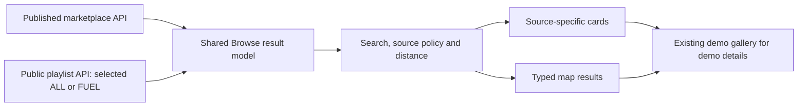

# Demo feedstocks in Browse

Status: approved and implemented, FUEL first and ALL afterward. See the [verification report](../verification/2026-10-22-browse-demos.md) for review, test and development-release evidence. Shared source data and commercial inventory were preserved.

## Problem and scope

Make the already public FUEL/LSU and ALL material examples discoverable through `/browse`, including its search and map, while preserving `/demo-feedstocks` as the dedicated presentation page. Apply the same result rules to `/buyer/browse` so signing in does not remove this discovery path. Keep commercial stock, demo examples and private drafts distinct.

The October 21 release report records 29 FUEL examples and 432 ALL examples. Live inspection on October 22 confirms the gallery's FUEL selector and 29/14/15 material/mapped/pending counts. The requested Browse URL currently applies a 100-mile radius; the observed session shows zero nearby commercial matches, 16 outside and two without a saved location. Those are observations for that session, not fixed product counts.

## Proposed experience

Default Browse to all results: existing marketplace listings plus published demo material examples. Group the results visibly by source and show separate counts. Use ALL as the canonical demo dataset in this mode. Offer source filters `All results`, `Marketplace`, and `Demo examples`, plus demo playlist (`ALL` or `FUEL/LSU`), company and role (`All`, `Seller offers`, `Buyer needs`). A selected FUEL playlist uses its own reviewed dataset rather than adding it to ALL.

Search material titles, material types, qualifiers and equivalents, plus approved public demo company names and available public country/postal metadata. Normalize CO₂ and CO2 consistently. Do not expand commercial search into private seller identities. Selecting a company must work even when its material is not an exact title match.

Every demo card and popup retains `Demo — not available for purchase`, its buyer/seller role, source status, estimate basis, price currency/unit/direction, volume period and location precision. Its action opens the matching example in `/demo-feedstocks` with playlist, company, role and selected material retained. Add a supported selected-material parameter and return context so browser Back returns to the original Browse filters and selection. No demo ID may enter a commercial detail, cart, checkout, quote or RFQ route.

Company profiles without materials and potential-network relationships remain accessible in the presentation gallery; they do not become stock cards. Preserve the requested removal of the private-draft panel. Inspection found that panel still present on public `/browse` although the previous release checked its absence on `/buyer/browse`; include both routes in this change's preservation check.

## Location and filter rules

- Keep an explicit 100-mile filter effective when a valid origin exists. Use each material's published point and identify distances calculated from approximate locations as approximate.
- Missing or conflicting coordinates remain pending. Exclude them from nearby results and map pins, show their matching count, and offer `Show matches with location pending` in a separate section. Offer `Show all distances` for outside-radius matches. Never silently claim these records are within the radius.
- If no usable origin exists, show that the distance filter could not be applied. Do not claim a radius search succeeded or invent an origin.
- Preserve anonymous commercial redaction. Its existing teaser rules differ from public demo geography, so evaluate source visibility and distance eligibility separately.
- The current Where input matches saved commercial location text; it is not a general geocoder. For this scope, support published demo country/postal matches explicitly. Ambiguous matches require an explicit origin choice; do not center on an arbitrary first company. Free-form address geocoding is outside this change.
- Existing price, quantity, grade and carbon filters apply only to marketplace results, with that scope visible in the UI and counts. Do not compare EUR with USD, annual volume with available stock, or missing carbon with zero. Demo-specific numeric filtering requires a separate currency/unit/period design.
- Keep source, playlist, role, company, query, distance and selected result stable through search, reload, reset and browser Back. Keep authorized buyer `portfolioId` separate from public playlist selection; preserve server denial rules.

## Architecture and ownership

Reuse the existing public playlist reads, parsers and fact formatters. Do not copy examples into commercial listing tables or broaden the commercial listings endpoint to expose drafts.



Proposed internal shape, not an API change:

```ts
type BrowseResult =
  | { kind: "marketplace"; key: string; listing: Listing }
  | { kind: "demo"; key: string; playlist: DemoPlaylistSlug;
      company: DemoPlaylistCompany; material: DemoPlaylistMaterial };

function selectBrowseResults(input: {
  listings: Listing[];
  demo: DemoPlaylistData | null;
  filters: BrowseFilters;
  origin: RadiusOrigin | null;
}): BrowseSelection;
```

The pure selector owns matching, distance disposition and source counts. Renderers exhaustively dispatch on `kind`. A shared hook owns independent loading/error states and selected-playlist reads. A demo API failure leaves commercial browsing usable but shows an explicit demo error; it never falls back to private drafts. Namespaced keys prevent commercial/demo and playlist ID collisions. Card and map output derive from the same selection.

Existing touchpoints:

- `apps/web/src/components/public/browse-page.tsx` and `components/buyer/buyer-browse-page.tsx`: source controls and shared selection integration.
- `apps/web/src/lib/api-demo-playlists.ts`, `demo-playlists.ts`, and public demo cards: reuse approved reads, validation, formatting and illustrations.
- `apps/web/src/components/public/listing-map.tsx`: typed pin/popup dispatch without treating demo IDs as commercial listing IDs.
- `apps/web/src/lib/radius-filter.ts`: reuse distance calculations while preserving source-specific visibility.
- `apps/web/src/components/public/demo-feedstocks-page.tsx`: selected-material/return navigation; retain standalone playlist, profile and network features.

Claude owns frontend implementation. Codex owns any necessary shared/backend contract edits and verifies public read boundaries. Use supervised Orca worktrees, the configured models/service settings, reciprocal review and combined checks before a development release. Assign each shared file one editor.

## Alternatives and decision

The recommended design composes approved reads in the frontend. It preserves the existing API and database boundaries and needs no stock migration. We accept client filtering over the current bounded dataset and maintain separate result types to prevent demo commerce actions.

A server-side combined search endpoint would centralize global sorting and pagination but introduce a new public contract and cache/withdrawal obligations. Reserve it for measured scale needs. Publishing demo records as ordinary stock is rejected because it would grant commercial meaning and actions to estimates and buyer needs.

ALL and FUEL overlap. Review found 26 shared UUIDs plus three equivalent material records with different dataset IDs. Concatenating and deduplicating by UUID produces 435 examples rather than ALL's 432. Choose one dataset per playlist selection. Do not merge same-title materials across companies or infer source identity from titles.

## Implementation and acceptance sequence

1. Freeze the baseline and agree result/filter semantics above. Preserve user-owned untracked guides and all current source/database records.
2. Build the result selector, URL-state handling and source-specific renderers against FUEL first. Prove buyer needs and pending locations behave correctly.
3. Enable canonical ALL selection, company/material search, typed map interactions and deep links back to the retained gallery. Keep commercial actions and redaction intact.
4. Run focused selector/navigation tests, backend public-boundary regressions, types, lint and web/admin builds as applicable. Use the real isolated FE/BE for integration checks.
5. After implementation approval, deploy only to development and repeat actual signed-out and signed-in browser stories on public and buyer Browse at desktop and 390px widths. Record the exact release and evidence.

Required acceptance stories:

- Search CO2/CO₂ and Encore; distinguish the CO₂ buyer need from seller offers. Test FUEL and ALL, company/role/category filters, clear/search/reload/Back and gallery return.
- Confirm ALL contains its canonical 432 demo materials without a FUEL duplicate union when no filters or radius apply and the published revision is unchanged. Keep commercial counts separate.
- Verify a deterministic 100-mile boundary, approximate distances, pending/conflicting locations, no-origin state and Show all distances. Cards and pins must agree; pending rows have no invented pins.
- Preserve EUR estimates, zero prices, seller-paid gate fees, ranges, annual volumes, source units and missing fields. Existing commercial-only filters must not silently apply to incompatible demo facts.
- Verify demo failure versus commercial failure separately, disabled/withdrawn demo removal, anonymous visibility/redaction, and denied buyer portfolio selection.
- Confirm zero demo commerce actions or commercial detail links; private APIs remain protected; `/demo-feedstocks` still supports its existing presentation features; the draft panel stays absent from both Browse routes.
- Compare protected business/source records before and after release. This feature requires no production change, source publication, account creation or database reset.

The first implementation task is the pure selector and its invariants. This document does not authorize implementation, publication or deployment by itself.
